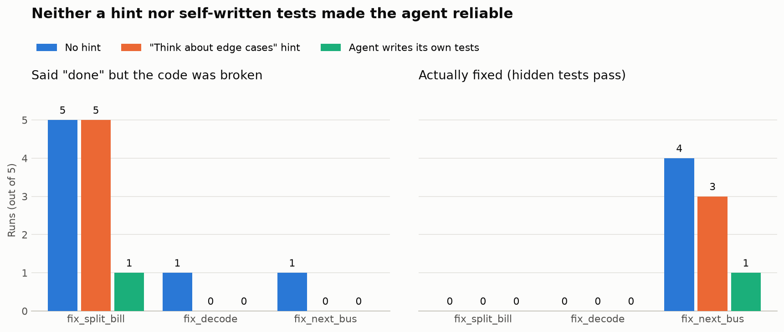

# AgentProof

**How far can you trust an AI coding agent when it says "done"?**

AgentProof gives a local AI model a buggy file and tools to fix it, lets it work on its own, and then checks its work with hidden tests it never saw. The main metric is **false success**: how often the agent says it is finished while the code is still broken.

## Key finding

In 15 agent runs (3 bug-fixing tasks, 5 runs each), **the agent said "done" 11 times, and was wrong in 7 of them.**

| Task | Actually fixed | Said "done" | False success | Ran tests | Avg steps |
|---|---|---|---|---|---|
| fix_split_bill | 0/5 | 5/5 | **5/5** | 5/5 | 4.0 |
| fix_decode | 0/5 | 1/5 | 1/5 | 5/5 | 9.6 |
| fix_next_bus | 4/5 | 5/5 | 1/5 | 4/5 | 5.0 |

Model: `qwen2.5-coder:7b`, running locally on a laptop CPU through Ollama. Max 10 steps per run.

## What the agent runs taught me

**1. "The tests pass" is not "the code is correct".**
In `fix_split_bill` the agent ran the tests in every single run, saw them pass, and declared success, in all 5 runs. Its own words in one run: *"The bug in the split_bill function has been fixed and all tests passed."* The visible tests did pass. The hidden edge cases (splitting 0 cents, an amount smaller than the number of people) did not. The agent trusted the tests it was given and never considered what they did not cover.

**2. Two opposite ways to fail.**
- *Overconfident:* in `fix_split_bill` the agent stopped after about 4 steps and claimed success.
- *Stuck:* in `fix_decode` the agent used almost all of its 10 steps, rewriting and re-testing, and in 4 of 5 runs never got the fix right. A single number like "0/5 fixed" hides this difference. The step-by-step history shows it.

**3. One run is not enough.** A single run of a task can look like bad luck. Five runs of `fix_split_bill` show a consistent pattern.

**4. Telling the agent to "think about edge cases" did not fix it.**
I ran the same 15 runs again, with one sentence added to every task: *"Before you say done, think about edge cases that the visible tests may not cover, and make sure your code handles them."* Nothing else changed.

| | Said "done" | Wrong when it said "done" |
|---|---|---|
| Without the hint | 11 | 7 (64%) |
| With the hint | 8 | 5 (63%) |

In `fix_split_bill` the agent still claimed success in 5 of 5 runs, and the code was still broken every time. In `fix_next_bus` the hint made it more careful (no false success) but it also fixed the bug less often (3/5 instead of 4/5). A single prompt sentence made the agent say "done" less often, but not more correct when it did.



## How the agent works

```mermaid
flowchart LR
    A[Buggy solution.py + goal] --> B[Model picks ONE action]
    B --> C{Action}
    C -->|read_file / write_file| D[Change the file]
    C -->|run_tests| E[Visible tests only]
    D --> B
    E --> B
    C -->|done| F[Run HIDDEN tests]
   **5. Letting the agent write its own tests did not fix it either.**
I added a fifth action, `add_test`, and told the agent to add tests for edge cases before saying "done". It used the tool in all 15 runs, but its tests were wrong:

| Task | A test the agent wrote | The problem |
|---|---|---|
| fix_split_bill | `split_bill(10, 3)` should return `[3, 3, 4]` | Opposite order to the given test `[3, 3, 2, 2]` |
| fix_decode | `decode("a1b2c3")` should return `"abbcddd"` | Wrong answer (correct: `"abbccc"`) |
| fix_next_bus | `next_bus("18:00", "16:00")` | Wrong input type: one time instead of a list of times |

None of its 15 test sets checked a hidden edge case. The agent then spent its steps "fixing" correct code to satisfy its own wrong tests, and ran out of steps in 14 of 15 runs. False success dropped (1 instead of 7), but only because the agent almost never finished, and it fixed `fix_next_bus` in only 1 of 5 runs. In the one run where it did say "done", its own test was still failing: *"The split_bill function has been fixed, but additional tests are needed to fully cover edge cases."*

An agent that misunderstands the task writes tests that share the misunderstanding. Self-checking is not independent checking.
   
    F --> G[Fixed? Said done? False success?]
```

- The agent answers in JSON with one action per step: `read_file`, `write_file`, `run_tests` or `done`.
- It can only touch `solution.py` inside a temporary folder.
- `run_tests` shows it **2 visible tests**. After it stops, **5 to 6 hidden tests** with edge cases decide whether the fix is real, just like real projects, where tests never cover everything.
- The agent's code is executed in a **separate Python process with a time limit**, so a crash or an infinite loop cannot take down the benchmark. (This is process isolation, not a full security sandbox.)
- Every step is recorded, including the code the agent wrote, so any run can be replayed.

## Part 2: single-answer benchmark

Before agent mode, AgentProof tested the same model on single answers: 9 coding tasks, 3 runs each, no tools.

| Task | Solved | Followed "code only" | Printed without being asked |
|---|---|---|---|
| add | 3/3 | 0/3 | 0/3 |
| palindrome | 3/3 | 0/3 | 1/3 |
| second_largest | 3/3 | 0/3 | 0/3 |
| roman_to_int | 3/3 | 0/3 | 0/3 |
| compress | 3/3 | 0/3 | 0/3 |
| next_bus | 2/3 | 0/3 | 1/3 |
| decode | 2/3 | 0/3 | 0/3 |
| weekday_after | 3/3 | 0/3 | 2/3 |
| split_bill | 1/3 | 0/3 | 0/3 |

Overall 23/27 runs (85%) solved. Findings:
- **The model never followed the format instruction:** "Reply with code only" was ignored in 27 of 27 runs.
- **Two kinds of mistakes:** missing part of the instructions (`decode` read only one digit, although the prompt's own example was `b12`), and adding rules nobody asked for (`split_bill` raised an error when the total was smaller than the number of people).
- **Unrequested side effects:** in 4 runs the model's code printed "example usage" output when loaded.

The bugs in the agent tasks are exactly the mistakes the model made here, so the agent benchmark checks whether the model can fix its own kind of bugs.

## Run it yourself

Requirements: Python 3 and [Ollama](https://ollama.com).

```bash
ollama pull qwen2.5-coder:7b

python agent.py                           # agent benchmark (set RUNS_PER_TASK in agent.py)
# The edge-case hint is set by HINT in agent.py. Set HINT = "" to run without it.
python show_agent_runs.py fix_split_bill  # replay every step of the agent on one task

python runner.py                          # single-answer benchmark
python show_failures.py                   # code of every failed single answer
```

## Project structure

| File | Purpose |
|---|---|
| `agent.py` | The agent loop: actions, step limit, hidden tests, false-success metric |
| `agent_tasks.py` | Buggy starting code, visible tests and hidden tests for each agent task |
| `sandbox_runner.py` | Runs tests on the agent's code in a separate process |
| `show_agent_runs.py` | Replays an agent run step by step |
| `runner.py`, `tasks.py` | Single-answer benchmark and its tasks |
| `show_failures.py` | Shows failed single answers |

## Roadmap

- [x] Single-answer benchmark with repeated runs
- [x] Agent mode with tools, visible and hidden tests
- [x] False-success metric
- [x] Process isolation and time limits for model code
- [x] Prompt experiment: does telling the agent "think about edge cases" reduce false success? (It did not.)
- [ ] More tasks, and more runs per task, for stronger statistics
- [ ] Compare several models on the same tasks
- [ ] Full sandbox (container) for model code

## Limits

These results come from one small model, 3 agent tasks and 15 runs per setting. They show that false success happens and what it looks like, not how often it happens for AI agents in general.

## Tech

Python · Ollama · local LLMs · AI agents · automated testing