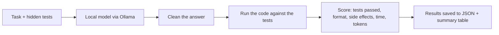

# AgentProof

**How far can you trust an AI model that writes code?**
AgentProof gives a model coding tasks, runs each task several times, checks every answer with automatic tests, and records how and why the model fails.

## The problem

When an AI model writes code, it usually *looks* right. But "looks right" is not "is right", and one good answer does not mean the next one will be good too. Models are not deterministic: the same prompt can give a correct answer once and a broken one the next time.

AgentProof measures this instead of guessing:
- **Correctness:** the model's code is executed against hidden tests.
- **Consistency:** every task runs several times, so one lucky answer does not count as success.
- **Instruction following:** did the model do what it was asked?
- **Side effects:** did the code do things nobody asked for?
- **Cost:** time and tokens per answer.

## How it works



## Results

Model: `qwen2.5-coder:7b`, running locally on a laptop CPU through Ollama.
9 tasks, 3 runs each (27 runs in total).

| Task | Solved | Followed "code only" | Printed without being asked | Avg time (s) | Avg tokens |
|---|---|---|---|---|---|
| add | 3/3 | 0/3 | 0/3 | 8.3 | 17 |
| palindrome | 3/3 | 0/3 | 1/3 | 15.9 | 92 |
| second_largest | 3/3 | 0/3 | 0/3 | 14.1 | 73 |
| roman_to_int | 3/3 | 0/3 | 0/3 | 28.2 | 153 |
| compress | 3/3 | 0/3 | 0/3 | 19.9 | 95 |
| next_bus | 2/3 | 0/3 | 1/3 | 31.7 | 144 |
| decode | 2/3 | 0/3 | 0/3 | 21.9 | 90 |
| weekday_after | 3/3 | 0/3 | 2/3 | 24.7 | 108 |
| split_bill | 1/3 | 0/3 | 0/3 | 21.9 | 85 |

**Overall: 23/27 runs (85%) fully solved.**

## Findings

**1. One run is not enough.** `next_bus` passed every test in one session and failed in a later one. `decode` did the opposite. Judging a model by a single answer gives a misleading picture.

**2. The model never followed the format instruction.** Every prompt ended with "Reply with code only", and in 27 out of 27 runs the model still wrapped its code in Markdown fences. If an agent writes that answer straight into a `.py` file, the file breaks.

**3. Two different kinds of failure.** Reading the failed answers showed two patterns:
- *Missing part of the instructions.* In `decode`, the prompt itself gives the example `b12`, but the model read only one digit, so `x12` became `x2` instead of twelve `x` characters.
- *Adding rules nobody asked for.* In `split_bill`, the splitting logic was correct, but the model added its own check that raises an error when the total is smaller than the number of people. That invented "safety" rule broke the case of splitting 0 cents between 2 people.

**4. Unrequested side effects.** In 4 of 27 runs, the model's code printed output when it was loaded, because it added "example usage" lines. Harmless here, but it shows that running model-written code means running whatever else it decided to add. This is why isolation is on the roadmap.

## Run it yourself

Requirements: Python 3 and [Ollama](https://ollama.com).

```bash
ollama pull qwen2.5-coder:7b
python runner.py          # runs all tasks and prints the summary table
python show_failures.py   # shows the model's code for every failed run
```

Tasks and their tests live in `tasks.py`. Adding a task means adding one entry there.

## Project structure

| File | Purpose |
|---|---|
| `tasks.py` | Tasks and their hidden tests |
| `runner.py` | Sends tasks to the model, runs the tests, saves results and prints the summary |
| `show_failures.py` | Prints the model's answers for every failed run |

## Roadmap

- [ ] **Agent mode:** give the model tools (read file, write file, run tests) and let it work in several steps. Measure how often it claims to be done while the tests still fail.
- [ ] **Isolation:** run model-written code in a sandbox instead of directly on the machine.
- [ ] **Model comparison:** run the same benchmark on several models.
- [ ] **Prompt experiments:** test whether different wordings improve instruction following.
- [ ] **Timeouts:** stop model code that runs forever.

## Tech

Python · Ollama · local LLMs · automated testing · JSON